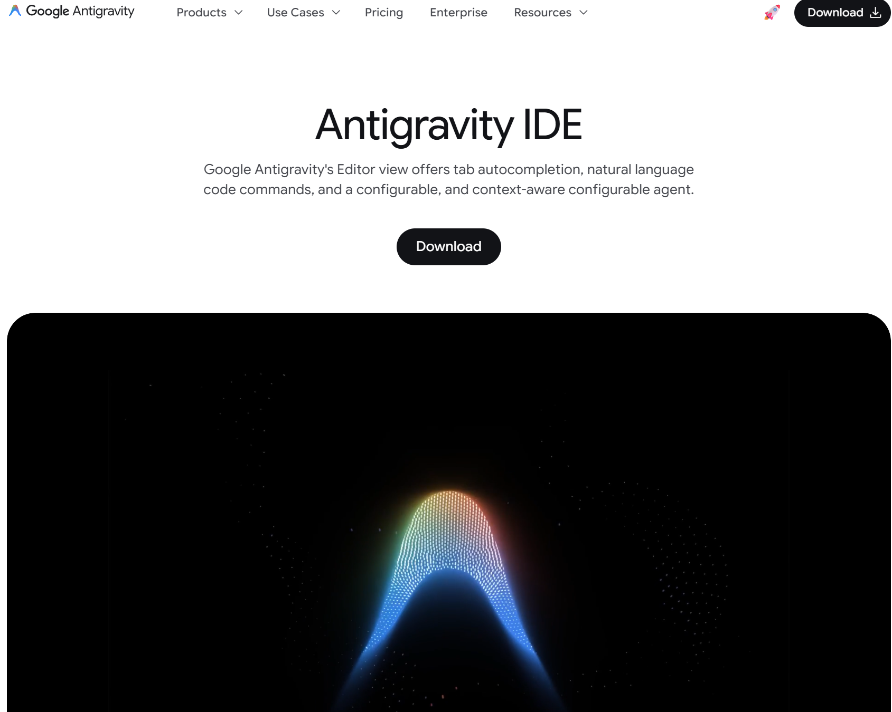
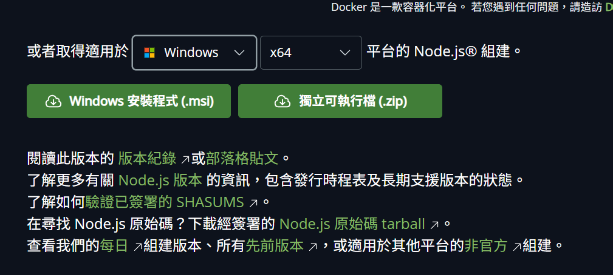
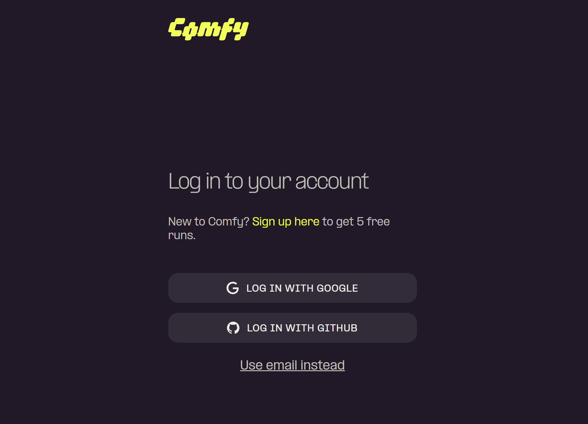
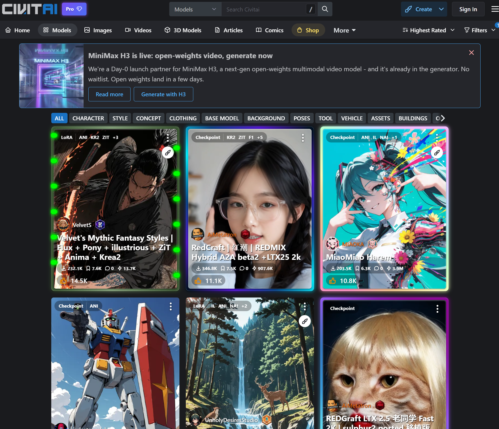
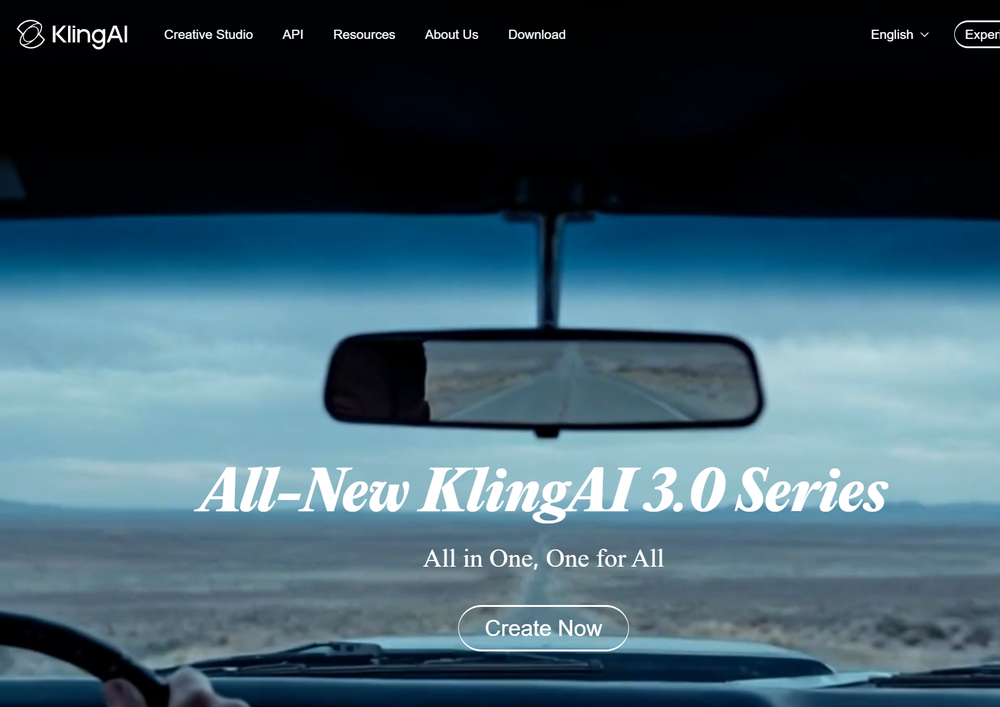

# Chapter 00: 準備工具

以前上課光安裝軟體就花掉半天？別擔心，這次我們只要準備這幾樣好用的工具。在正式進入課程之前，請確保您已經準備好以下環境，這些是我們今天一日實戰課程的必備武器。

## 任務一：安裝你的數位畫室

- **Agent 工作區**：Google Antigravity 是我們課程使用的 Agent 工具。你可以把它想成一間能讀取專案檔、查資料、使用工具並回報成果的數位工作室。請依課程使用版本完成安裝與登入，並確認 Agent 能讀取你建立的練習資料夾。
  👉 **[查看 Google Antigravity 官方說明](https://antigravity.google/docs/overview)**
  
  
  
  > 💡 **選模型時看任務，不背排行榜**
  >
  > 模型名稱、額度、價格與可用功能會更新，也可能因帳號或地區不同。課堂只要求你確認四件事：能否讀取這次的文字與圖片、能否查閱官方資料、能否使用工作區工具、輸出品質是否符合任務。正式工作前，再到官方方案頁與當下介面確認費用、容量和權限。
- **外掛底層引擎**：Node.js (快遞引擎) 是為了讓後續能順利下載擴充外掛 (SKILL) 的底層程式。**注意：你的電腦預設是沒有這個東西的，必須手動安裝！** 安裝 Node.js 後，系統就會自動獲得一個叫做 `npx` 的「快遞小幫手指令」，我們後續所有的大師技能都要靠它來下載。
  👉 **[點我下載 Node.js (LTS 版本)](https://nodejs.org/)**
  
  
  
  *(⚠️ 新手避坑：進入官網後，**Windows 系統** 請直接下載 Windows Installer (.msi) 版本，**Mac 系統** 請下載 macOS Installer (.pkg) 版本，**不需要** 透過 Docker 安裝！下載後一路按 Next 即可。)*
- **網頁瀏覽器**：現代化瀏覽器，請使用最新版的 Google Chrome 或 Microsoft Edge 瀏覽器。

## 任務二：註冊雲端生圖與影片模型帳號

- **雲端生圖平台**：Comfy Cloud 帳號 是我們的「美術外包中心」，透過雲端平台進行生圖實戰（它有著像心智圖一樣連連看的介面），免去本地安裝與硬體限制的痛苦。請事先註冊並確認可登入。
  👉 **[點我註冊 Comfy Cloud](https://comfy.org/)**
  
  
- **模型擴充圖庫**：Civitai 模型庫帳號 是後續實作下載進階 LoRA 模型時必備，需登入才能取得完整搜尋與下載權限。
  👉 **[點我註冊 Civitai](https://civitai.com/)**
  
  
- **動態影片生成**：Kling AI (可靈) 或 Luma AI 帳號，是最終章實作將你的設計稿轉為逼真動態影片時必備。
  👉 **[點我註冊 Kling AI](https://klingai.com/)** / **[點我註冊 Luma AI](https://lumalabs.ai/dream-machine)**
  
  
