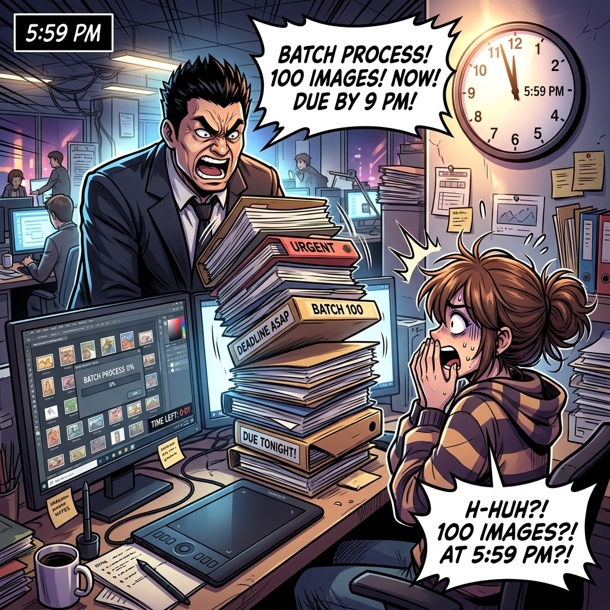
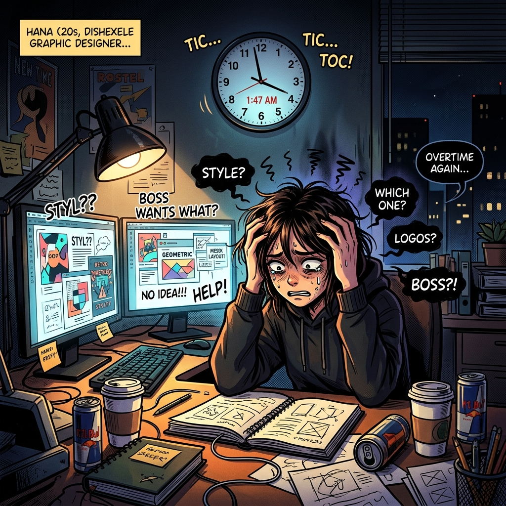

# Chapter 03: 用專案 Skills 引導長任務與需求釐清

## 1. 痛點場景

🕴️ **老闆**：下班前把這 100 張圖套用前衛時尚風格處理完！明早開會要看！細節你自己想！


👨 **你**：(心想：今晚又要睡在公司了... 而且我根本不知道他要的前衛時尚細節是什麼！難道沒有可以自己想細節、又可以自動處理完的工具嗎？)


---

## 2. 階段一：長效任務與定時回報 (放手讓它做)

### 2.1 觀念一：長效任務與定時回報
*   **目標追蹤 (/goal)**：這是本專案附帶的 Skill。它會把高階目標整理成完成條件、里程碑與下一步，持續推進可自主完成的工作；遇到權限、外部發布或會改變方向的決定時仍會停下確認。
*   **排程與背景工作**：是否能定時執行、背景運作或推播，要看目前使用的產品與帳號功能。先在介面確認真的有排程能力，再設定合理頻率；一段提示詞本身不會憑空建立排程器。

### 2.2 實作一：準時下班的魔法
*(預計時間：20 分鐘)*
*   先用 3 張測試圖確認規格，再輸入：`「/goal 請把資料夾中的草圖轉成 PNG。先列出檔案數、輸出位置、命名規則與驗收條件；用 3 張小測試，確認後再批次處理。遇到錯誤記錄檔名與原因，不要略過。」`

> `/goal` 幫你固定終點與檢查方式，但不會替你補完模糊的創意方向。批次工作要先小測試，確認後再放大。

### ⚠️ 實作避坑 TIP
*   **目標要明確**：使用 `/goal` 時，任務終點必須清晰 (例如「100 張全部轉換為 PNG」)。如果說「幫我畫到好為止」，Agent 會不知道什麼時候該停下來。
*   **別把排程當提示詞**：只有產品確實提供排程或背景任務功能時才能使用；設定前確認通知、成本與停止方式。

---

☕ **大腦冷卻時間 / 實作緩衝**：
完成小測試後，停下來看一次錯誤紀錄與驗收條件。接著處理另一個常見問題：如果我們自己還說不清楚要什麼，Agent 該怎麼幫忙？

---

*(2.2 實作一結束)*

👨 **你**：雖然 `/goal` 很神，但如果我連自己要什麼都不知道，它也只會產出一堆我不要的垃圾啊！有沒有什麼指令是可以「幫我想靈感」的？

## 3. 階段二：靈魂拷問與永久記憶 (把 AI 當專家)

### 3.1 觀念二：靈魂拷問與永久記憶
*   **靈感拷問面試官 (/grill-me)**：`/grill-me` 指令，當你靈感枯竭或需求模糊時，用這個指令讓 AI 反過來「面試你」。它會不斷逼問你細節（例如：燈光要多暗？髮型是什麼材質？），直到釐清真正的設計需求。
*   **經驗沉澱 (/learn)**：這是本專案附帶的 Skill。它只把已驗證、可重用、具體可檢查的做法寫進 AGENTS.md 或相關 Skill；本次才適用的偏好留在 brief。

**💬 `/grill-me` 互動對話範例**：
```text
👨 你：/grill-me 我想設計一套前衛的銀河系挑染造型，但我沒想法。
🤖 Agent：收到！為了幫你產出最精準的設定，請問：
   1. 這個角色的職業是什麼？(駭客/傭兵/還是財閥高層？)
   2. 身上主要的發光體顏色是什麼？(霓虹粉/螢光綠？)
👨 你：他是個駭客，主要顏色是螢光綠，而且戴著面具。
🤖 Agent：收到！(將靈感轉化為精確的設計需求清單...)
```

### 3.2 實作二：靈感壓榨機與傳家寶
*(預計時間：25 分鐘)*
*   輸入：`「/grill-me 我想為銀河系挑染系列設計一套前衛髮型，但目前只有模糊方向」`。完成 brief 並做出一個經確認的結果後，再輸入：`「/learn 把這次已驗證、換專案仍適用的做法整理成規則；本次角色偏好留在 brief。」`

> 體驗從「不知道要什麼」到「被 AI 引導出具體靈感」的過程，並親眼見證它自動把這個過程寫成經驗法則！

### ⚠️ 實作避坑 TIP
*   **避免把偏好寫成永遠規則**：使用 `/learn` 前確認這條做法已有效，而且未來相似任務也適用。個案資訊留在 brief。
